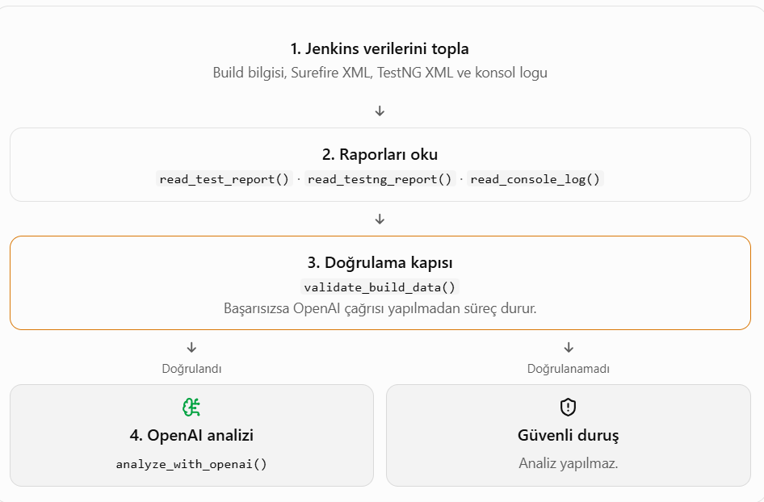
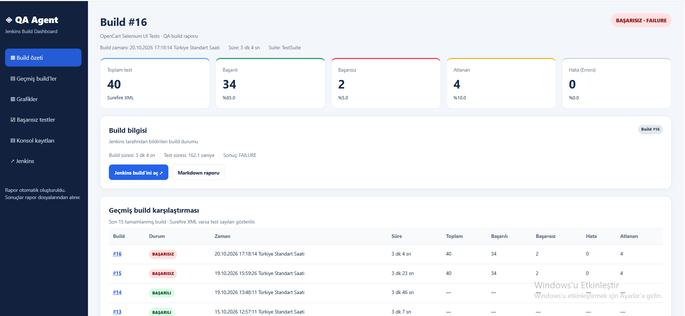
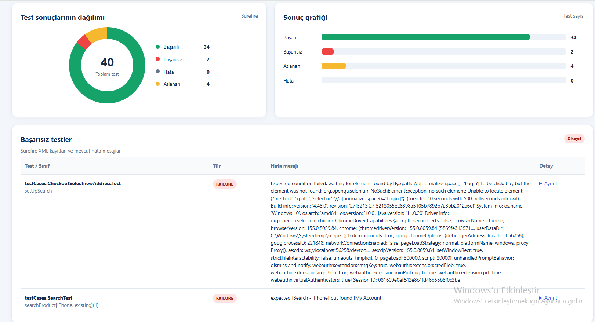
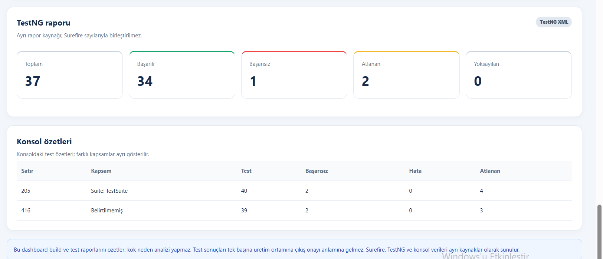

# QA Agent — Evidence-Based Jenkins Test Analysis

An AI-assisted QA tool that collects Jenkins test results, validates report consistency, and supports evidence-based investigation of automated test failures.

[English](#english) | [Türkçe](#türkçe)

## English

### Overview

QA Agent is a Python-based project designed to help investigate automated UI test results generated by Jenkins, Maven, TestNG, and Selenium WebDriver.

Instead of sending test data directly to an AI model, the agent first checks whether key test counts reported by the Surefire XML report and Jenkins console summary are consistent. If the validation gate detects an inconsistency or cannot establish a clear reporting scope, the analysis is stopped.

When validation passes, the agent sends the collected evidence to the OpenAI API for a structured analysis.

### Workflow



1. Collect build information and test artifacts from Jenkins.
2. Parse the Surefire XML report, TestNG report, and console log.
3. Validate report counts and check for ambiguous console summaries.
4. Stop the analysis if the validation gate fails.
5. If validation passes, request an evidence-based analysis from the OpenAI API.
6. Present the analysis for further investigation.

### Dashboard

The project also includes a separate dashboard script that generates an HTML build overview and a Markdown report.



**Graph view**



**TestNG report view**



### Technologies

- Python
- Jenkins REST API
- Maven
- Selenium WebDriver
- TestNG and Surefire reports
- OpenAI API
- HTML and Markdown reporting

### Validation and Reliability

The validation gate compares the Surefire XML test counts with the Jenkins console summary and stops when multiple console summaries make the reporting scope ambiguous.

A matching set of counts is a consistency check, not absolute proof that every artifact belongs to the same build. TestNG counts are also evaluated separately because their scope can differ from Surefire totals.

The AI-generated analysis is intended to support investigation, not replace QA judgment. Findings should be verified against the underlying test code and execution evidence.

### Setup

Requirements:

- Python
- Access to a Jenkins instance and its build artifacts
- An OpenAI API key for AI-assisted analysis

Install the Python dependency:

```bash
pip install -r requirements.txt
```

Configure the required environment variables before running the agent:

- `JENKINS_URL`
- `JENKINS_USER`
- `JENKINS_API_TOKEN`
- `OPENAI_API_KEY`

Do not hardcode credentials or commit API tokens to GitHub.

Run the main agent:

```bash
python qa_agent.py
```

Run the dashboard generator separately:

```bash
python qa_agent_dashboard.py
```

The main agent and dashboard are separate scripts.

### Limitations

- The validation gate checks consistency but cannot guarantee that all artifacts originate from the same build solely from matching counts.
- AI analysis may suggest hypotheses; suspected root causes must be verified using source code and test evidence.
- The dashboard presents build information and reports; it does not itself establish the root cause of a failure.

---

## Türkçe

### Proje Hakkında

QA Agent; Jenkins, Maven, TestNG ve Selenium WebDriver ile yürütülen otomatik UI testlerinin sonuçlarını toplamaya, rapor tutarlılığını kontrol etmeye ve başarısız testlerin kanıta dayalı incelenmesine yardımcı olan Python tabanlı bir projedir.

Agent, test verilerini doğrudan yapay zekâya göndermek yerine önce Surefire XML raporundaki test sayılarıyla Jenkins konsol özetini karşılaştırır. Tutarsızlık tespit edilirse veya birden fazla konsol özeti nedeniyle hangi sonuçların esas alınacağı net değilse analiz durdurulur.

Doğrulama başarılı olduğunda toplanan kanıtlar, yapılandırılmış analiz için OpenAI API'ye gönderilir.

### Çalışma Akışı


1. Jenkins'ten build bilgileri ve test dosyaları toplanır.
2. Surefire XML, TestNG raporu ve konsol logu ayrıştırılır.
3. Rapor sayıları ve belirsiz konsol özetleri kontrol edilir.
4. Doğrulama başarısız olursa analiz durdurulur.
5. Doğrulama başarılı olursa OpenAI API üzerinden kanıta dayalı analiz istenir.
6. Analiz, daha ayrıntılı inceleme için sunulur.

### Dashboard

Projede ayrıca HTML formatında build özeti ve Markdown raporu oluşturan ayrı bir dashboard betiği bulunur.


**Grafik görünümü**


**TestNG raporu görünümü**


### Kullanılan Teknolojiler

- Python
- Jenkins REST API
- Maven
- Selenium WebDriver
- TestNG ve Surefire raporları
- OpenAI API
- HTML ve Markdown raporlama

### Doğrulama ve Güvenilirlik

Doğrulama kapısı, Surefire XML test sayılarını Jenkins konsol özetiyle karşılaştırır. Birden fazla konsol özeti bulunduğunda rapor kapsamı belirsiz kabul edilir ve analiz durdurulur.

Sayıların eşleşmesi bir tutarlılık kontrolüdür; bütün dosyaların kesin olarak aynı build'e ait olduğunu tek başına kanıtlamaz. TestNG raporunun kapsamı Surefire sonuçlarından farklı olabileceği için bu veriler ayrıca değerlendirilir.

Yapay zekâ analizi QA kararının yerine geçmez. Bulguların test kodu ve çalıştırma kanıtlarıyla doğrulanması gerekir.

### Kurulum

Gereksinimler:

- Python
- Jenkins sunucusuna ve build dosyalarına erişim
- Yapay zekâ analizi için OpenAI API anahtarı

Gerekli Python paketini yükleyin:

```bash
pip install -r requirements.txt
```

Çalıştırmadan önce aşağıdaki ortam değişkenlerini yapılandırın:

- `JENKINS_URL`
- `JENKINS_USER`
- `JENKINS_API_TOKEN`
- `OPENAI_API_KEY`

Kimlik bilgilerini doğrudan koda yazmayın veya API anahtarlarını GitHub'a göndermeyin.

Ana agent'ı çalıştırın:

```bash
python qa_agent.py
```

Dashboard'ı ayrı çalıştırın:

```bash
python qa_agent_dashboard.py
```

Ana agent ve dashboard birbirinden ayrı betiklerdir.

### Sınırlamalar

- Yalnızca sayıların eşleşmesi, bütün dosyaların aynı build'e ait olduğunu kesin olarak kanıtlamaz.
- Yapay zekânın önerdiği olası nedenler, kaynak kod ve test kanıtlarıyla doğrulanmalıdır.
- Dashboard build bilgilerini ve raporları sunar; tek başına kök neden analizi yapmaz.
